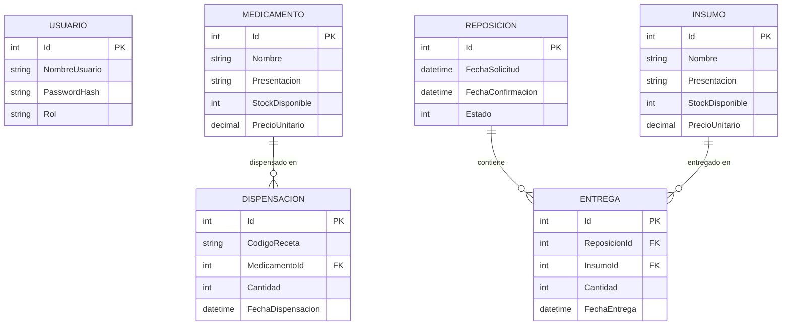

# Modelo de Dominio y Esquema de Datos --- PharmaLink

Este documento especifica las entidades de dominio (POCOs), tipos de datos, restricciones de integridad y configuraciones de Entity Framework Core para PharmaLink.

---

## 1. Entidades de Dominio (`Models/`)

Todas las entidades son clases C# planas (*Plain Old C# Objects*) decoradas con Data Annotations para validaciones estructurales básicas y tipos SQL explícitos.

### 1.1 `Usuario.cs` (Seguridad y Control de Acceso)
Representa a los usuarios con credenciales de acceso para la API.
```csharp
namespace PharmaLink.Models;

public class Usuario
{
    public int Id { get; set; }

    [Required, MaxLength(50)]
    public string NombreUsuario { get; set; } = string.Empty;

    [Required]
    public string PasswordHash { get; set; } = string.Empty;

    [Required, MaxLength(20)]
    public string Rol { get; set; } = "Usuario"; // "Usuario" o "Administrador"
}
```

### 1.2 `Medicamento.cs`
Catálogo de medicamentos disponibles para prescripción y dispensación.
```csharp
namespace PharmaLink.Models;

public class Medicamento
{
    public int Id { get; set; }

    [Required, MaxLength(150)]
    public string Nombre { get; set; } = string.Empty;

    [Required, MaxLength(100)]
    public string Presentacion { get; set; } = string.Empty; // Ej. "Comprimidos 500mg", "Jarabe 120ml"

    [Range(0, int.MaxValue)]
    public int StockDisponible { get; set; }

    [Column(TypeName = "decimal(18,2)")]
    [Range(0.0, 1000000.0)]
    public decimal PrecioUnitario { get; set; }

    // Propiedad de navegación
    public List<Dispensacion> Dispensaciones { get; set; } = new();
}
```

### 1.3 `Insumo.cs`
Materiales médicos e insumos hospitalarios gestionados para reposición.
```csharp
namespace PharmaLink.Models;

public class Insumo
{
    public int Id { get; set; }

    [Required, MaxLength(150)]
    public string Nombre { get; set; } = string.Empty;

    [Required, MaxLength(100)]
    public string Presentacion { get; set; } = string.Empty; // Ej. "Caja x 100 unidades", "Frasco 500ml"

    [Range(0, int.MaxValue)]
    public int StockDisponible { get; set; }

    [Column(TypeName = "decimal(18,2)")]
    [Range(0.0, 1000000.0)]
    public decimal PrecioUnitario { get; set; }

    // Propiedad de navegación
    public List<Entrega> Entregas { get; set; } = new();
}
```

### 1.4 `Dispensacion.cs`
Registro de entrega efectiva de un medicamento asociada a una receta validada externamente.
```csharp
namespace PharmaLink.Models;

public class Dispensacion
{
    public int Id { get; set; }

    [Required, MaxLength(100)]
    public string CodigoReceta { get; set; } = string.Empty;

    public int MedicamentoId { get; set; }

    [ForeignKey(nameof(MedicamentoId))]
    public Medicamento? Medicamento { get; set; }

    [Range(1, int.MaxValue)]
    public int Cantidad { get; set; }

    public DateTime FechaDispensacion { get; set; } = DateTime.UtcNow;
}
```

### 1.5 `Reposicion.cs`
Encabezado de orden de reposición de stock.
```csharp
namespace PharmaLink.Models;

public enum EstadoReposicion
{
    Solicitada = 1,
    Confirmada = 2,
    Cancelada = 3
}

public class Reposicion
{
    public int Id { get; set; }

    public DateTime FechaSolicitud { get; set; } = DateTime.UtcNow;

    public DateTime? FechaConfirmacion { get; set; }

    public EstadoReposicion Estado { get; set; } = EstadoReposicion.Solicitada;

    // Colección de insumos/detalles entregados en esta reposición
    public List<Entrega> Entregas { get; set; } = new();
}
```

### 1.6 `Entrega.cs`
Detalle de insumo entregado dentro de una orden de reposición.
```csharp
namespace PharmaLink.Models;

public class Entrega
{
    public int Id { get; set; }

    public int ReposicionId { get; set; }

    [ForeignKey(nameof(ReposicionId))]
    public Reposicion? Reposicion { get; set; }

    public int InsumoId { get; set; }

    [ForeignKey(nameof(InsumoId))]
    public Insumo? Insumo { get; set; }

    [Range(1, int.MaxValue)]
    public int Cantidad { get; set; }

    public DateTime FechaEntrega { get; set; } = DateTime.UtcNow;
}
```

---

## 2. Diagrama Entidad-Relación (ER)



---

## 3. Reglas de Negocio de Dominio

1. **Stock no Negativo**:
   - `StockDisponible >= 0` en todo momento para medicamentos e insumos.
   - Cualquier intento de descontar una cantidad mayor al stock actual debe generar un conflicto (`409 Conflict`) y abortar la operación.
2. **Atomicidad de Dispensación**:
   - Una dispensación NUNCA se registra si la receta externa es inválida o si no hay stock suficiente.
   - La inserción en `Dispensaciones` y el decremento en `Medicamentos.StockDisponible` deben ejecutarse dentro de la misma transacción de base de datos.
3. **Máquina de Estados de Reposición**:
   - Una reposición nace en estado `Solicitada`.
   - El stock de `Insumos` **NO se incrementa al solicitar**, sino **únicamente al confirmar la entrega** (`Confirmada`).
   - Una reposición ya `Confirmada` o `Cancelada` no puede volver a confirmarse (prevención de doble acreditación de stock).
4. **Integridad Referencial**:
   - No se permite eliminar un medicamento si posee dispensaciones históricas registradas (restricción de clave foránea `Restrict`).

---

## 4. Configuración en `Context/PharmaLinkContext.cs`

```csharp
using Microsoft.EntityFrameworkCore;
using PharmaLink.Models;

namespace PharmaLink.Context;

public class PharmaLinkContext(DbContextOptions<PharmaLinkContext> options) : DbContext(options)
{
    public DbSet<Usuario> Usuarios => Set<Usuario>();
    public DbSet<Medicamento> Medicamentos => Set<Medicamento>();
    public DbSet<Insumo> Insumos => Set<Insumo>();
    public DbSet<Dispensacion> Dispensaciones => Set<Dispensacion>();
    public DbSet<Reposicion> Reposiciones => Set<Reposicion>();
    public DbSet<Entrega> Entregas => Set<Entrega>();

    protected override void OnModelCreating(ModelBuilder modelBuilder)
    {
        base.OnModelCreating(modelBuilder);

        // Índice único en NombreUsuario
        modelBuilder.Entity<Usuario>()
            .HasIndex(u => u.NombreUsuario)
            .IsUnique();

        // Precisión para decimales en SQLite / EF Core
        modelBuilder.Entity<Medicamento>()
            .Property(m => m.PrecioUnitario)
            .HasConversion<double>(); // En SQLite los decimales se convierten a double o texto para compatibilidad

        modelBuilder.Entity<Insumo>()
            .Property(i => i.PrecioUnitario)
            .HasConversion<double>();

        // Restricción de eliminación en cascada
        modelBuilder.Entity<Dispensacion>()
            .HasOne(d => d.Medicamento)
            .WithMany(m => m.Dispensaciones)
            .HasForeignKey(d => d.MedicamentoId)
            .OnDelete(DeleteBehavior.Restrict);

        modelBuilder.Entity<Entrega>()
            .HasOne(e => e.Reposicion)
            .WithMany(r => r.Entregas)
            .HasForeignKey(e => e.ReposicionId)
            .OnDelete(DeleteBehavior.Cascade);

        modelBuilder.Entity<Entrega>()
            .HasOne(e => e.Insumo)
            .WithMany(i => i.Entregas)
            .HasForeignKey(e => e.InsumoId)
            .OnDelete(DeleteBehavior.Restrict);
    }
}
```
